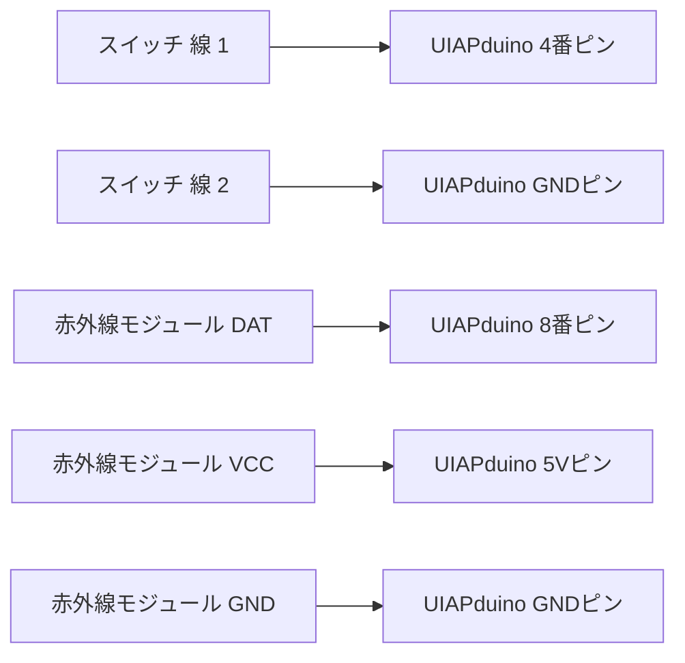
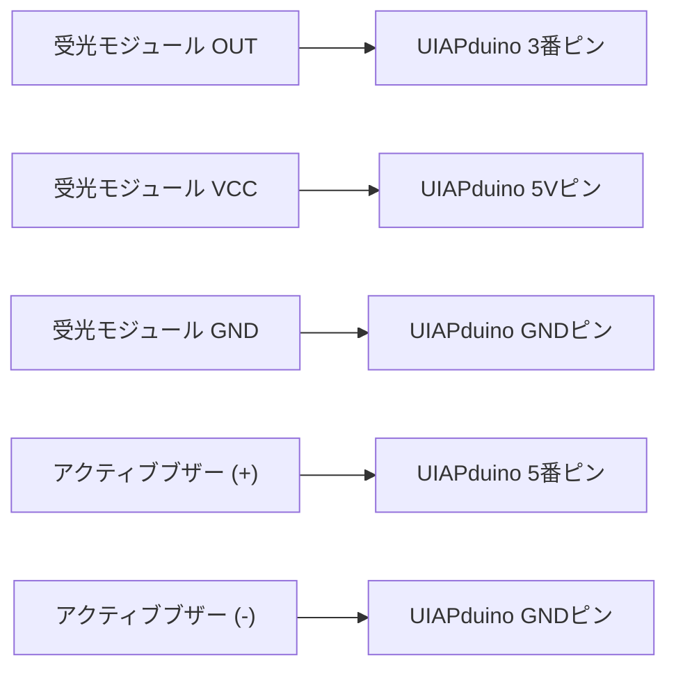
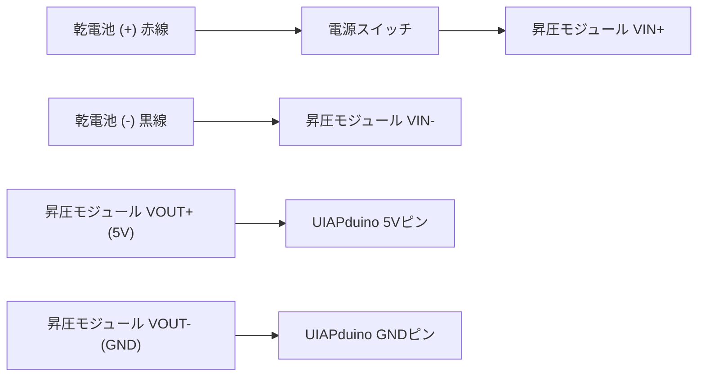

# 2026Bunkasai - 赤外線レーザータグ（IRサバゲー）

文化祭展示・ゲーム運用向けの、最小構成かつ確実な動作を目指した赤外線レーザータグ（電子サバゲー）システムです。

- コンセプト: 「赤外線を受光したら、ブザーが鳴る。」
- プログラムコード: すべて `src/` 配下に格納（送信機: `src/tx/`、的・受信機: `src/rx/`）
- 電源: 送信機・受光部ともに 乾電池1本（1.5V）＋ 昇圧モジュール（5V出力） で完全コードレス動作

---

## 1. 送信機（銃）の配線

何番ピンに何を繋ぐかの一覧と配線図です。

### 送信機の配線図



### 送信機の接続表

| 接続元パーツ | パーツ側端子 | 接続先 (UIAPduino) | 備考 |
|---|---|---|---|
| プッシュスイッチ | 線 1 | **4番ピン** | 押すとGNDに導通 |
| プッシュスイッチ | 線 2 | **GNDピン** | 極性なし（線1と線2は逆でも動作） |
| 赤外線モジュール (IR Transmitter V1221) | `DAT` | **8番ピン** | 38kHz 信号出力 |
| 赤外線モジュール (IR Transmitter V1221) | `VCC` | **5Vピン** | 電源供給 |
| 赤外線モジュール (IR Transmitter V1221) | `GND` | **GNDピン** | グランド |

### 送信機の動作
- ボタンを押すと、マイコン基板上の オレンジ色「L」LED（デバッグ用）が点灯 し、赤外線LEDから 38kHz変調パルスが照射 されます。
- ボタンを離すと消灯・停止します。

---

## 2. 的（受光部・ブザー）の配線

受光部側の何番ピンに何を繋ぐかの一覧と配線図です。

### 的（受光部）の配線図



### 的（受光部）の接続表

| 接続元パーツ | パーツ側端子 | 接続先 (UIAPduino) | 備考 |
|---|---|---|---|
| 38kHz 受光モジュール (VS1838B等) | `OUT` | **3番ピン** | 受光検知信号 |
| 38kHz 受光モジュール (VS1838B等) | `VCC` | **5Vピン** | 電源供給 |
| 38kHz 受光モジュール (VS1838B等) | `GND` | **GNDピン** | グランド |
| 5V 自励式アクティブブザー | `+` (長い足) | **5番ピン** | ブザー制御信号 |
| 5V 自励式アクティブブザー | `-` (短い足) | **GNDピン** | グランド |

### 的（受光部）の動作
- 受光部が 38kHz 赤外線を一度検知すると、3番ピン が LOW になり、5番ピン に接続されたブザーが約2.5秒間鳴動し続けます。
- 鳴動終了後、ブザーは自動停止します（再度受光するとまた約2.5秒鳴動します）。

---

## 3. 乾電池1本（1.5V）昇圧電源の配線（送信機・的 共通）

送信機・受光部ともに、単3または単4乾電池1本から昇圧モジュールを使って 5V を作って給電します。

### 電源配線図



### Amazonで購入可能な推奨昇圧モジュール

| タイプ | 商品名 / ASIN | 特徴 | リンク |
|---|---|---|---|
| **超小型基板タイプ（USBなし・最も推奨）** | xuuyuu DC-DC昇圧コンバーターモジュール 10個セット (0.9-5Vから5Vに昇圧) (ASIN: B0H3843YRN) | USB端子がなく約11mm×10.5mmの極小サイズ。USBケーブルの出っ張りが一切なく、銃や的のケース内に最もコンパクトに内蔵可能。 | [Amazon商品ページ (B0H3843YRN)](https://www.amazon.co.jp/dp/B0H3843YRN) |
| USBポート付きタイプ | KKHMF DC-DC USB 0.9V-5V に 5V 電圧変換ブースターモジュール (ASIN: B077XRWK3Q) | USB Type-A メス端子付き。UIAPduinoへUSBケーブルで直接給電可能。 | [Amazon商品ページ (B077XRWK3Q)](https://www.amazon.co.jp/dp/B077XRWK3Q) |

- 入力電圧範囲: `0.9V 〜 5V`
- 出力電圧: `5V` 固定

---

## 4. プログラムファイル構成（src/ 配下）

プログラムはすべて `src/` ディレクトリ配下に格納されています。

```text
2026Bunkasai/
├── README.md              # 本書（接続ピン番号・配線図一覧）
└── src/
    ├── tx/                # 送信機（銃）プログラム
    │   ├── tx.c           # ch32fun用ネイティブCコード
    │   ├── Makefile       # make flash で書き込み
    │   ├── funconfig.h    # MCU設定
    │   ├── tx.ino         # Arduino IDE用スケッチ
    │   └── main.cpp       # PlatformIO用ソース
    ├── rx/                # 的（受信機）アクティブブザー版
    │   ├── rx.c           # ch32fun用ネイティブCコード（2.5秒発音）
    │   ├── Makefile       # make flash で書き込み
    │   ├── funconfig.h    # MCU設定
    │   ├── rx.ino         # Arduino IDE用スケッチ
    │   └── main.cpp       # PlatformIO用ソース
    └── rx_passive/        # 的（受信機）パッシブブザー（他励式/圧電）版
        ├── rx.c           # ch32fun用ネイティブCコード（2.7kHzトーンで2.5秒発音）
        ├── Makefile       # make flash で書き込み
        ├── funconfig.h    # MCU設定
        ├── rx.ino         # Arduino IDE用スケッチ
        └── main.cpp       # PlatformIO用ソース
```

---

## 5. 書き込み方法

### 送信機（銃）を書き込む場合
1. UIAPduino のリセットボタン（金色の丸いボタン）を押したままPCにUSB接続。
2. ターミナルで以下を実行：
   ```bash
   make -C src/tx flash
   ```

### 的（受信機・アクティブブザー版）を書き込む場合
1. UIAPduino のリセットボタン（金色の丸いボタン）を押したままPCにUSB接続。
2. ターミナルで以下を実行：
   ```bash
   make -C src/rx flash
   ```

### 的（受信機・パッシブブザー/圧電スピーカー版）を書き込む場合
1. UIAPduino のリセットボタン（金色の丸いボタン）を押したままPCにUSB接続。
2. ターミナルで以下を実行：
   ```bash
   make -C src/rx_passive flash
   ```
