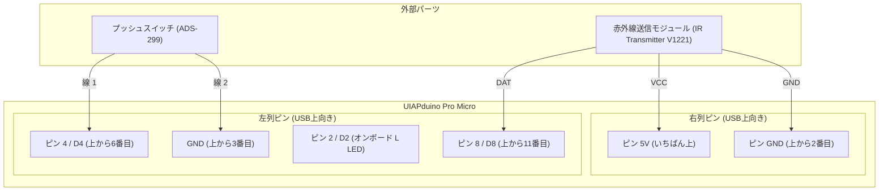
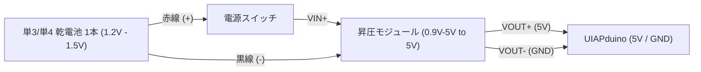

# 赤外線送信機（銃・トリガー）仕様書

用意された実機パーツ（赤外線送信モジュール ＆ プッシュボタンスイッチ）に完全対応した送信機仕様書・組み立てマニュアルです。

---

## 1. 使用パーツ

1. 赤外線送信モジュール: `IR Transmitter V1221`（3ピンモジュール）
2. プッシュボタンスイッチ: ミヤマ電器 `ADS-299`（押しボタン・モーメンタリSW）
3. マイコンボード: UIAPduino Pro Micro（CH32V003搭載）

---

## 2. 配線・組み立てガイド

UIAPduino を USB Type-C コネクタを「上」にして机に置いた状態で接続します。

### 送信機の配線接続図



---

### 1. プッシュボタンスイッチ (`ADS-299`)
使用している端子（押した時に導通が切れる2線）をそのまま接続します。

| スイッチ端子 | UIAPduino ピン | 差し込み場所の目安 |
|---|---|---|
| 端子の線 1 | `4` | 左側の列・上から 6 番目（シルク「`4`」） |
| 端子の線 2 | `GND` | 左側の列・上から 3 番目（シルク「`GND`」） |

> [!NOTE]
> スイッチに極性（プラス・マイナス）はありませんので、2本の線はどちらを `4`・`GND` に繋いでも正常に動作します。

---

### 2. 赤外線送信モジュール (`IR Transmitter V1221`)
モジュールのピン横に書かれている文字を見て繋ぎます。基板上に抵抗等が組み込まれているため直結できます。

| モジュール側端子 | UIAPduino ピン | 差し込み場所の目安 | 備考 |
|---|---|---|---|
| `DAT` | `8` | 左側の列・上から 11 番目（シルク「`8`」） | 38kHz 変調信号出力 |
| `VCC` | `5V` | 右側の列・いちばん上（シルク「`5V`」） | 電源供給 |
| `GND` | `GND` | 右側の列・上から 2 番目（シルク「`GND`」） | グランド |

---

## 3. 乾電池1本（1.5V）駆動用 昇圧回路（Amazon選定＆配線）

送信機（銃）および受光部（的）の両方を乾電池1本（単3または単4 / 1.5V、充電池 1.2V）で動作させる場合、マイコンやモジュールが要求する 5V を出力するために昇圧DC-DCコンバータ（ステップアップ）モジュールが必要です。

### Amazonで入手可能な推奨モジュール

| タイプ | 特徴 | Amazon検索キーワード | リンク |
|---|---|---|---|
| A. 超小型基板タイプ（推奨） | 約11mm×10mmの極小サイズ。リード線を直接ハンダ付けして筐体（銃や的）の中にコンパクトに内蔵可能。 | `DC-DC 昇圧 0.9V 5V 小型` | [Amazonで検索](https://www.amazon.co.jp/s?k=DC-DC+%E6%98%87%E5%9C%A7+0.9V+5V+%E5%B0%8F%E5%9E%8B) |
| B. USB出力ポート付きタイプ | USB Type-A メス端子が実装されており、短いUSBケーブルでUIAPduinoに給電可能。ハンダ付け不要で試作向き。 | `DC-DC USB 昇圧モジュール 0.9V 5V` | [Amazonで検索](https://www.amazon.co.jp/s?k=DC-DC+USB+%E6%98%87%E5%9C%A7%E3%83%A2%E3%82%B8%E3%83%A5%E3%83%BC%E3%83%AB+0.9V+5V) |

- 入力電圧範囲: `0.9V 〜 5V`（乾電池1本が消耗して0.9Vに低下しても昇圧継続）
- 出力電圧: `5V` 固定
- 出力電流容量: 乾電池1本（1.5V）入力時に約 `200mA 〜 300mA`
  - 送信機（tx）の消費電流: 約 30〜80mA（LED照射時）
  - 受光部（rx）の消費電流: 約 20〜50mA（ブザー発音時）
  - どちらも乾電池1本＋昇圧モジュールで余裕を持って連続駆動可能です。

### 電源の配線図（送信機・受光部 共通）



> [!TIP]
> 電池の消耗を防ぐため、電池のプラス(+)線と昇圧モジュールの `VIN+` の間にスライドスイッチなどの「電源ON/OFFスイッチ」を1つ挟むことを推奨します。

---

## 4. 繋いだ後の動作チェック

1. 電源投入:
   - 電池（またはUSBケーブル）を接続して電源を入れます（基板上の青い「PWR」LEDが点灯）。
2. ボタン押下チェック:
   - スイッチ（ADS-299）を押すと、基板中央付近の オレンジ色「L」LED（デバッグ用）が点灯 します。
   - 指を離すと 「L」LED が消灯 します。
3. 赤外線送受信テスト:
   - 受信側（受光モジュール D3）に向けてボタンを押すと、受信側のブザー（D5）が鳴る ことを確認します。

---

## 5. プログラムファイルおよびビルド方法

- [tx.c](file:///Users/hiro/2026Bunkasai/tx/tx.c): `ch32fun` 用ネイティブCコード（現在書き込み済み）
- [Makefile](file:///Users/hiro/2026Bunkasai/tx/Makefile): ビルド・書き込み用Makefile
- [tx.ino](file:///Users/hiro/2026Bunkasai/tx/tx.ino): Arduino IDE用スケッチ
- [main.cpp](file:///Users/hiro/2026Bunkasai/tx/main.cpp): PlatformIO / C++用ソース

### CLIでのビルドおよび書き込み（再書き込み時）
1. UIAPduinoのリセットボタン（金色の丸いボタン）を押しながらPCにUSB接続。
2. ターミナルで以下を実行：
   ```bash
   make -C tx flash
   ```
